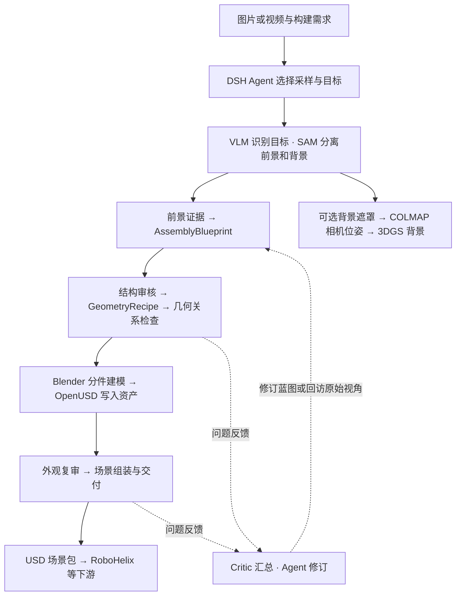
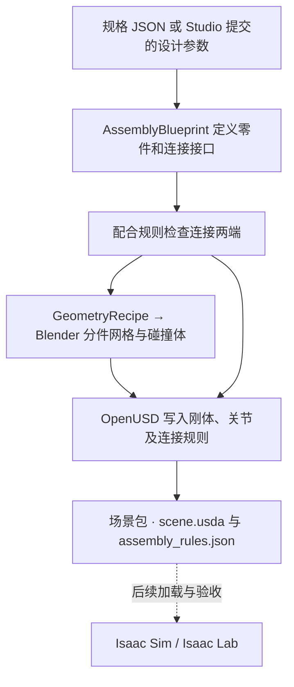
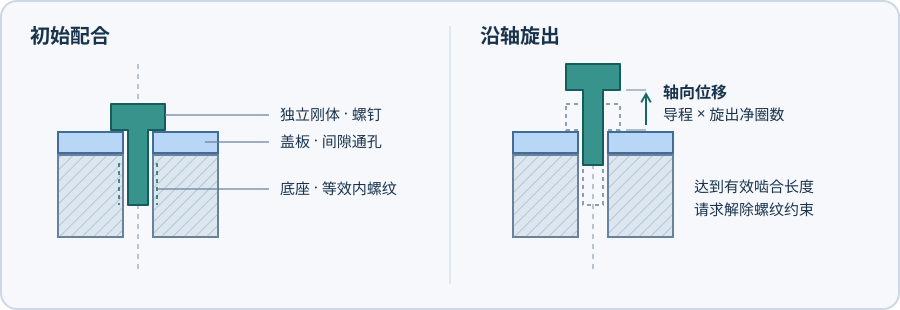

# SceneCreator

从图片、离线视频或明确的零件规格构建 Isaac Sim 场景，为 RoboHelix 等下游系统提供带来源记录的交互资产和 USD 场景包。

当前代码基于 2026-11-11 的 `43d3c72`，保留 Agent Harness、内部组件、Studio、资产物理验证和交付适配。
当前工作区已移除开发测试、合成演示、单场景实验及其兼容入口。原代码可由该提交恢复。

## 图片与视频重建



Studio 的 DSH Agent 负责采样、目标选择和修订决策。CLI 使用同一套 Workflow。图中交付路径需配置 `usd_python`。默认处理一个前景目标，物理验证与背景重建按需启用。3DGS 背景目前单独输出。旧 `generate` / `scene-harness` 提供多对象批处理。

## 已知规格生成





*螺钉盖板设计示意。盖板孔按螺杆外径留间隙，底座内螺纹由导程约束表示，螺钉在 USD 中保留独立刚体。尺寸和脱扣行为待 Isaac 验收。*

`scenecreator workflow start --design` 接收 M3、M4、M5 不同杆长的螺钉盖板，或指定开角的限位铰链。已知规格入口由 Blender 建模、OpenUSD 写出候选包。螺纹预紧、起拧和续拧阻力、脱扣由 Isaac 步前钩子处理。接入方式和输入示例见 [Isaac USD 工作流](docs/ISAAC_USD_WORKFLOW.md)。

## 使用入口

```bash
python -m pip install --no-deps -e .
scenecreator --help
scenecreator workflow start --help
scenecreator studio --help
scene-perception --help
```

- `scenecreator workflow start / advance` 执行固定流程、提交决策或恢复。
- `scenecreator studio` 提供原生 DSH 会话、证据、候选、调用记录和资源状态。
- `scenecreator generate` 执行已有多对象构建 Harness。
- `scene-perception` 提供感知、证据、背景和独立构建阶段。
- `scenecreator handoff / inspect` 打包并核对 USD 依赖。
- `scenecreator tool / tool-test` 保留电动螺丝刀生成与运行时功能验证。

旧 `envcreator` 命令仍是兼容入口。既有 DSH 工具名和场景包格式沿用原有标识。

模型推理、Blender 建模、OpenUSD 导出和 Isaac 物理验证需要准备各自的运行环境。旧工具及冻结 v9 台架仍使用 Artisan。Linux/NVIDIA 执行路径见 [环境配置](docs/HOST_SETUP.md)。Mac 可用于代码维护与入口、构建检查。

## 代码组织

| 位置 | 职责 |
| --- | --- |
| `harness/` | Workflow、批处理构建、场景组装和验证调度 |
| `components/` | 供 Workflow、原生工具和 Studio 共享的组件操作 |
| `construction/` | 证据、装配蓝图、结构修订、Blender/Artisan 与背景重建 |
| `standard_interactions/`、`tools/` | 已声明的交互机制、工具资产及运行时物理验证 |
| `artifacts/`、`execution/` | 产物索引、哈希、调用记录和运行环境适配 |
| `integration/` | 场景依赖包、DSH 配置与 ClawSpine 接口 |
| `workbench/`、`integrations/studio/` | 服务、作业、原生插件与前端 |

[流程与调用关系](docs/WORKFLOW_OVERVIEW.md) · [架构](docs/ARCHITECTURE.md) · [清理记录](docs/HARNESS_CLEANUP.md) · [文档索引](docs/README.md)

仿真资产、原始媒体、权重、密钥和运行结果保存在 Git 之外。资产物理检查覆盖报告所列行为，机器人任务成功由下游评测记录。

第一方源码采用 [GPL-3.0-only](LICENSE)。第三方软件、数据与模型沿用各自许可。
