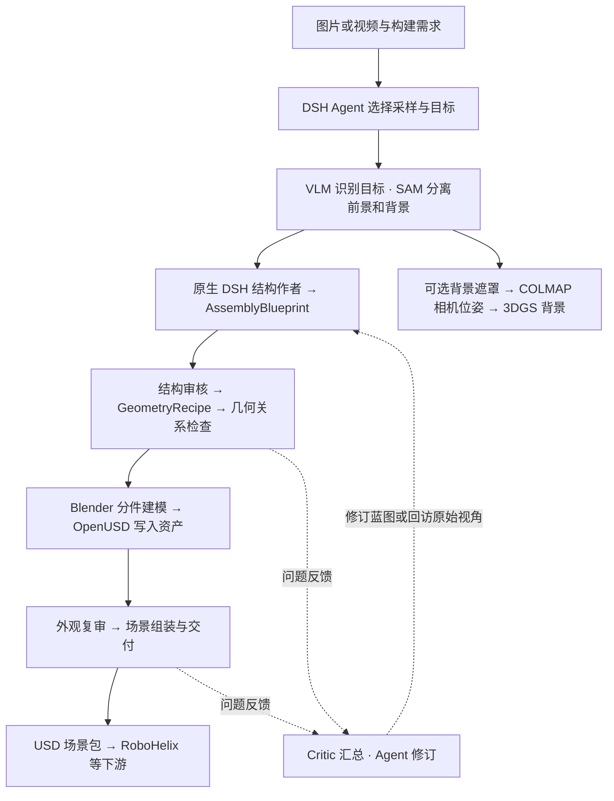
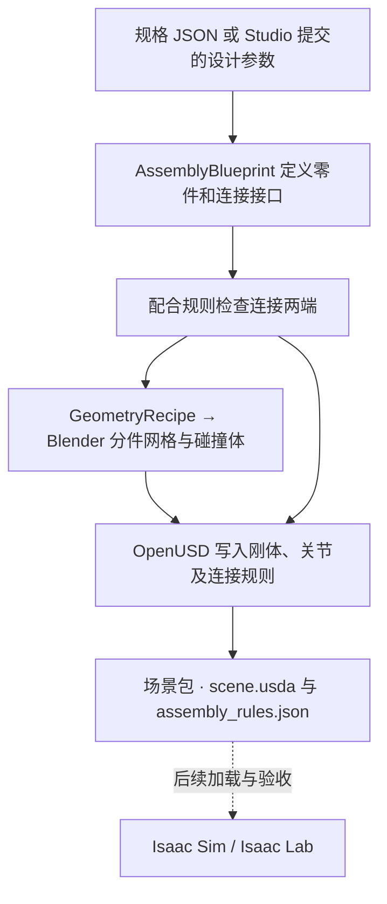

# SceneCreator

从图片、离线视频或明确的零件规格构建 Isaac Sim 场景，为 RoboHelix 等下游系统提供带来源记录的交互资产和 USD 场景包。

`isaacsim` 分支保存 2026-11-15 迁移前的当前工作区源码：物理执行仍使用 Isaac Sim / Isaac Lab 的 **PhysX 后端**。Newton / MuJoCo Warp 尚未接入本分支的测试平台。分支保存不构成新验收；本次提交按要求未运行测试。其他工作树中尚未合入的装配图和机械运行时开发不属于此快照。

仓库提供 Agent Harness、Studio、装配蓝图、资产物理验证和 USD 交付，并保留原生结构提交的协议测试源码。已移除的开发测试、合成演示和单场景实验可在 [清理前版本](https://github.com/FelixtheFelinae/SceneCreator/tree/43d3c72b3f7699e32eb297816828a5ed9874a232) 查阅。

## 图片与视频重建



Studio 的新原生调用默认由 DSH Agent 负责采样、目标选择、结构蓝图提交和修订。CLI 使用同一套 Workflow，以 `--structure-author native_dsh` 显式选择该结构作者；原有内部 VLM 路径仍可使用。原生作者可按机械常识补全未见内部，以 `prior/inferred/assumed` 记录，不能标为观察或测量。作者接受、几何可构建和物理功能分别记录。

SAM 分割保留；内部 VLM 仍用于感知、几何配方和渲染复审，尚未全部迁移到原生作者。任务模型使用独立的 DSH 配置，不能自动复用 `VLM_API_KEY`。入口及边界见 [Studio 原生结构作者](docs/SCENECREATOR_STUDIO.md#原生结构作者与常识推断)。

图中交付路径需配置 `usd_python`。默认处理一个前景目标，物理验证与背景重建按需启用。COLMAP 估计背景相机位姿，3DGS 生成视觉背景，后者目前单独输出，不作为接触几何。旧 `generate` / `scene-harness` 提供多对象批处理。

## 已知规格生成




*螺钉盖板设计示意。盖板孔按螺杆外径留间隙，底座内螺纹由导程约束表示，螺钉在 USD 中保留独立刚体。尺寸和脱扣行为待 Isaac 验收。*

`scenecreator workflow start --design` 接收 M3、M4、M5 不同杆长的螺钉盖板，或指定开角的限位铰链。已知规格入口由 Blender 建模、OpenUSD 写出候选包。螺纹预紧、起拧和续拧阻力、脱扣由 Isaac 步前钩子处理。接入方式和输入示例见 [Isaac USD 工作流](docs/ISAAC_USD_WORKFLOW.md)。

## 使用入口

```bash
python -m pip install --no-deps -e .
scenecreator --help
scenecreator workflow start --help
scenecreator studio --help
scene-perception --help
```

- `scenecreator workflow start / advance` 执行固定流程、提交决策或恢复。
- `scenecreator studio` 提供原生 DSH 会话、证据、候选、调用记录和资源状态。
- `scenecreator generate` 执行已有多对象构建 Harness。
- `scene-perception` 提供感知、证据、背景和独立构建阶段。
- `scenecreator handoff / inspect` 打包并核对 USD 依赖。
- `scenecreator tool / tool-test` 保留电动螺丝刀生成与运行时功能验证。

旧 `envcreator` 命令仍是兼容入口。既有 DSH 工具名和场景包格式沿用原有标识。

模型推理、Blender 建模、OpenUSD 导出和 Isaac 物理验证需要准备各自的运行环境。旧工具及冻结 v9 台架仍使用 Artisan。Linux/NVIDIA 执行路径见 [环境配置](docs/HOST_SETUP.md)。Mac 可用于代码维护与入口、构建检查。

Python 包入口要求 Python 3.12+；上面的 `--no-deps` 安装假设已准备依赖。Studio 使用 Node 24 和外部 ClawSpine 的原生 DSH。物理运行依赖另行部署，冻结 v9 台架绑定自己的容器版本，不能用本机新版本的安装状态替代原协议。新 clone 不含场景资产、控制器权重或本机运行环境。

## 物理实现与验证范围

| 路径 | 当前实现 | 结果边界 |
| --- | --- | --- |
| 通用资产验证 | `harness/physics.py` 调度独立 Isaac worker，按声明协议检查刚体、铰链、旋转及固定比耦合响应 | 只覆盖实际执行并留存报告的行为 |
| 冻结 v9 工具台架 | `standard_interactions/`、`tools/` 使用 PhysX mimic 导程、等效预紧和有界摩擦；原生运行时处理工具啮合与传力 | 三紧固件布局、理想夹持等条件明确记录；已有失败仍保留 |
| 声明式螺钉盖板 | `execution/isaac_thread.py` 步前钩子施加等效夹紧载荷并按相对转角、位移请求解除连接 | 本快照仍待接收端挂载及单独验收；`thread_clear` 不等于完整取出 |
| 机器人接入 | `integration/clawspine.mjs` 交付场景并调用外部 ClawSpine 原生启动器 | DSH 拥有任务推理和机器人动作；台架通过不代表机器人拆卸成功 |

当前螺纹属于等效约束模型，没有解析真实螺牙接触、内部材料应力或磨损。理想腕部固定、磁吸和指定压盖力不构成真实抓持或左手稳定验证。详见 [物理资产要求](docs/PHYSICAL_ASSET_REQUIREMENTS.md)、[冻结台架协议](docs/STANDARD_INTERACTIONS.md)和 [ClawSpine 接入](docs/SCENECREATOR_CLAWSPINE.md)。

## 代码组织

| 位置 | 职责 |
| --- | --- |
| `harness/` | Workflow、批处理构建、场景组装和验证调度 |
| `components/` | 供 Workflow、原生工具和 Studio 共享的组件操作 |
| `construction/` | 证据、装配蓝图、结构修订、Blender/Artisan 与背景重建 |
| `standard_interactions/`、`tools/` | 已声明的交互机制、工具资产及运行时物理验证 |
| `artifacts/`、`execution/` | 产物索引、哈希、调用记录和运行环境适配 |
| `integration/` | 场景依赖包、DSH 配置与 ClawSpine 接口 |
| `workbench/`、`integrations/studio/` | 服务、作业、原生插件与前端 |

[架构与当前缺口](docs/ARCHITECTURE.md) · [流程与调用关系](docs/WORKFLOW_OVERVIEW.md) · [机械资产标准草案](docs/MECHANICAL_ASSET_STANDARD.md) · [文档索引](docs/README.md)

仿真资产、原始媒体、权重、密钥和运行结果保存在 Git 之外。临时 MuJoCo 键盘驾驶、桌面查看器、光标兼容处理及独立仿真迁移包仅供本地使用，不随此分支上传；主线的资产生成、场景导出和物理验证源码保留。资产物理检查覆盖报告所列行为，机器人任务成功由下游评测记录。

第一方源码采用 [GPL-3.0-only](LICENSE)。第三方软件、数据与模型沿用各自许可。
