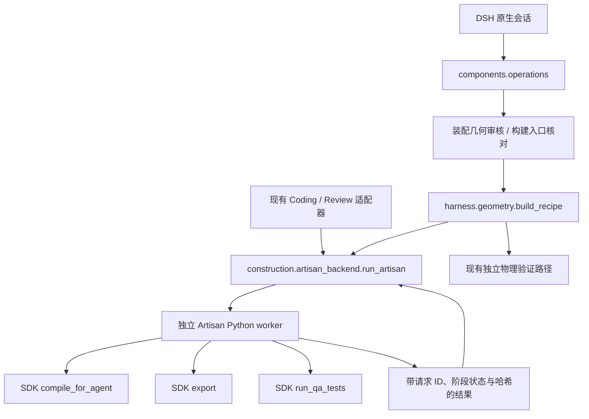

# Artisan 后端拆分：第一轮实现

本轮把 EnvCreator 对 Artisan 的执行边界从模型调用适配器中移出，保留原有 SDK、生成代码和 DSH 会话。未修改外部 Artisan 源码，未新增任务模型循环，也未实现 Mechanical Assembly IR。

## 实际调用路径



`construction/artisan_backend.py` 直接提供 `run_artisan`、`child_environment`。`harness/geometry.py` 直接依赖后端，不再为了执行 SDK 而导入模型适配器。

## 后端操作与兼容性

Python 入口：

```python
from roboenv_perception.construction.artisan_backend import run_artisan

# python 和 bundle 均为 pathlib.Path；bundle 是本轮候选的独立目录。
compiled = run_artisan(python, bundle, mode="compile")
exported = run_artisan(python, bundle, mode="export", formats=["mjcf", "usd"])

# 原有调用保持可用：编译通过后导出 URDF、MJCF、USD。
legacy_build = run_artisan(python, bundle)
qa = run_artisan(python, bundle, mode="qa")
```

| 操作 | 必需输入 | 行为与产物 |
| --- | --- | --- |
| `compile` | `model.py` | 调用 SDK 编译；写 `compile.json`，不导出资产 |
| `export` | `model.py`、当前输入对应的成功 `compile.json` | 核对编译结果和相关文件，再导出所选格式；写 `export.json` |
| `build` | `model.py` | 兼容原有“编译后导出”；写 `build.json`；不会额外伪造一份独立 `compile.json` |
| `qa` | `model.py`、`qa_tests.py` | 调用现有 SDK QA；有效测试发现缺陷时返回反馈，执行错误抛出异常 |
| `union` | `inputs/*.obj` | 保留网格合并；这是显式修改输入的操作，不是只读审核；不要求导入 SDK runtime |

这些细分操作目前通过 Python 后端和 worker CLI 使用；本轮未增加 DSH 工具或 GUI 按钮。原有 DSH 构建和 Review 流程通过兼容入口使用新协议。

每次后端调用创建 `.artisan-requests/<request_id>.json`、同 ID 的 `.result.json` 和 `.log`。顶层 `<operation>.json`、`<operation>.log` 保留最近一次结果，方便旧调用方读取。直接执行 worker 的旧二参数形式也保留请求和结果；其标准输出由直接调用方负责收集。

结果保留原有 `passed`、`outcome`、`exports`、`failures` 等字段，并增加 `backend_result`：

- `schema_version = envcreator.artisan-result/1`。
- `request_id`、`operation` 与本次请求对应。
- `input_sha256`：存在的 `model.py`、`blueprint.json`、`recipe.json`、`build-spec.json` 和整个 `inputs/` 文件树；QA 额外绑定测试源，export 额外绑定编译结果。
- `worker_sha256`、`backend_sha256`：绑定本轮 EnvCreator 执行器代码。
- `phases`：分别记录 compile / export / qa / union 的 `passed`、`failed`、`not_run`。
- `artifact_sha256`：记录当前编译报告以及导出目录内实际生成文件的哈希，包含打包的 Mesh 和其他依赖文件。
- `execution_status`：`completed` 或 `error`；`failure_domain` 记录发生问题的执行阶段，QA 检出缺陷为 `qa_findings`。
- `physics_status` 固定为 `not_run`。编译、导出、SDK QA 和 union 都不能替代仿真功能实验。

父进程只接受当前请求的独立结果文件，不再把旧的 `build.json` 当作本轮成功。导出前把原 `export/` 移到本次请求的 `.previous-export` 目录，避免缺少本次产物时误用旧文件；旧目录作为历史保留，顶层旧报告中的路径不再代表可继续使用的当前产物。重新编译时也保留上次编译报告副本。工作目录应按候选隔离，不支持多个请求同时修改同一目录。

超时或调用中断会终止本次后端进程组。进程被终止或请求本身无效时，可能只有请求与日志，没有完整结果；调用方会将其视为执行失败。子进程沿用去除模型凭据和 Python 路径污染的环境策略；这不是完整的安全隔离。

## 装配审核到构建的衔接

`harness/assembly.py` 保留现有解析式检查及其边界：主要检查 +Z 螺栓轴线、孔隙、承压叠层、长度和直线工具通道。`geometrically_plausible` 表示该范围内合理，不证明预紧、摩擦、螺纹接触、装配动力学或机器人操作。

新增 `audit_record` / `require_audit`，`persist_audit` 使用同一记录格式。`verification` 字段绑定蓝图、完整几何配方、证据引用集合和是否强制装配检查。原有顶层结果保留。

组件路径已修正：

1. `assembly_audit` 沿用几何配方允许的图像与检索证据，不再重置为仅图像引用。
2. `build` 接受有效的 `geometrically_plausible` 结果；在真正构建前，基于当前蓝图与配方重新执行确定性检查，并比对完整记录。
3. 修改尺寸、质量假设、连接假设、证据引用或蓝图语义后，需要重新审核。篡改审核内容也不能仅凭成功状态进入构建。
4. 有紧固件但删掉连接计划时，不能仅靠省略任务中的装配关键词跳过检查。
5. 历史审核文件仍可读；缺少新候选身份的报告需重新审核，不能直接作为新构建的准入结果。
6. 主 Harness 的 `persist_audit` 调用也写入同一候选身份；其原有逐轮审核、修复路径保留。

该记录不是加密签名；审核器是确定性受信代码，完整记录比对用于阻止过期或不一致状态，不用于抵御拥有整个工作目录修改权限的攻击者。

## 物理失败反馈

`PhysicsResult` 新增 `failure_domain`，默认 `unclassified`。`harness/run.py` 汇总时保留该字段，供现有 `repair_policy.route_physics_failures` 使用。超时、非正常退出、缺失报告或输入变化等已知执行故障归入 `test_harness`；通用物理审核中的失败不会自动猜成物体几何错误。

现有策略仍只允许明确归因为 `object_geometry` / `instance_binding` 且有失败报告的情况触发物体修复。未归因失败、标准件缺陷和执行故障停止并记录。本轮没有新增自动诊断算法，也没有声称通用 worker 能给出完整的机械故障归因。

## 验证与限制

历史开发验证见[清理前记录](https://github.com/FelixtheFelinae/NJU-agentic-3D-roboenv-mesh/blob/43d3c72b3f7699e32eb297816828a5ed9874a232/docs/ARTISAN_BACKEND.md)。当前分支已删除开发测试，保留后端状态协议与资产审核。Mac 上的代码检查不能证明实际 Artisan 导出或 Isaac 功能验证通过。

输入绑定目前覆盖约定的工作目录文件，不是任意 Python 依赖发现器；未锁定整个 Artisan 安装树、第三方包版本或运行环境。导出文件哈希保证列入清单的文件未变化，不证明所有格式引用都有效、碰撞质量合格或仿真可执行。SDK 内部仍可能在导出时重新加载或编译模型，API 分开不等于 SDK 已彻底解耦。

## 下一步：最小 Mechanical Assembly IR

2026-11-09 更新：已开始统一前端描述，P0 实际实现和限制见
[ASSEMBLY_BLUEPRINT.md](ASSEMBLY_BLUEPRINT.md)，运行记录见
[P0 报告](https://github.com/FelixtheFelinae/NJU-agentic-3D-roboenv-mesh/blob/43d3c72b3f7699e32eb297816828a5ed9874a232/reports/ASSEMBLY_BLUEPRINT_P0_20261109.md)。下文保留本次后端拆分完成时的建议；
目前新增的描述层仍未替代全部 GeometryRecipe / AssemblyPlan 或机械功能验证。

下一任务应从确定的装配描述输入开始，新增最小 IR 和现有 Blueprint / GeometryRecipe / AssemblyPlan 的适配器，明确零件定义与实例、单位与局部坐标系、接口及 Mate 引用、证据与假设。先用轴孔或螺栓台架做离线往返与错误引用测试，再连接实际后端；避免先增加 Agent 或直接扩展端到端视频流程。
