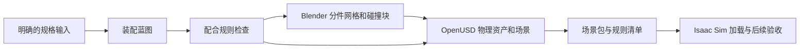

# 直接生成 Isaac USD

已知规格场景使用 `AssemblyBlueprint` 和 `GeometryRecipe`。程序先解析零件规格和配合规则，再调用 Blender 生成分件网格，最后由独立的 OpenUSD 解释器写入刚体、碰撞体、关节和可释放螺纹的绑定。场景包保留 `scene/scene.usda`、规则和蓝图快照、文件哈希。候选包的状态为 `unverified`。



## 配置与入口

在 Studio TOML 中设置 `blender` 和 `usd_python`。`usd_python` 指向能导入 `pxr` 的 Python。声明式场景使用本地设计 JSON、Blender 和 OpenUSD。 [配置示例](../configs/studio.example.toml)

```bash
scenecreator workflow start \
  --config configs/local-studio.toml \
  --task '生成一组可拆螺钉盖板' \
  --design /absolute/path/to/screw-cover.json \
  --output /absolute/path/to/new-scene
```

`screw-cover.json` 中全部长度使用米，力矩使用 N·m。以下载荷和力矩是仿真假设，需按后续任务条件配置。

```json
{
  "kind": "screw_cover",
  "screw_spec": "M4x0.7@1",
  "shaft_length_m": 0.012,
  "thread": {
    "engagement_m": 0.004,
    "unload_travel_m": 0.00035,
    "preload_N": 10.0,
    "breakaway_torque_Nm": 0.2,
    "running_torque_Nm": 0.04
  }
}
```

同规格可改 `shaft_length_m`。目前登记了 `M3x0.5@1`、`M4x0.7@1`、`M5x0.8@1` 三种单线右旋规格。杆长与盖板厚度、底座深度和有效啮合长度一起检查。孔径可由规格提供的中系列间隙值生成，也可用 `hole_diameter_m` 指定。圆形盖板和底座都用分段凸碰撞体保留孔道，底座内螺纹由导程约束表示。

铰链使用 `{"kind": "hinged_cover", "open_angle_deg": 110}`，生成闭合零位及 `0–110°` 的原生旋转关节。Studio 的 `envcreator_workflow_start` 可在 `params.declared_design` 中提交同样的数据。

`--design` 使用独立的候选构建路径。背景和物理选项保持默认关闭，后续在 Isaac 中单独验收生成的场景包。

## 螺纹运行时与交付

`execution/isaac_thread.py` 提供 `IsaacThreadRuntime(stage)`。接收端在场景加载并初始化物理后创建实例，在每个 `sim.step()` 前调用 `runtime.step()`。目前钩子默认使用 CPU NumPy tensor view。它从已组成的 USD 关系读取刚体和关节路径，在实际螺钉与底座的相对旋转和轴向位移达到脱扣条件时关闭连接。状态变更写入 session layer；重新载入原始场景可恢复初始装配。新场景还未接入 RoboHelix 的自动加载钩子。

完成后，工作流摘要的 `deliverables.bundle` 指向场景包。包内的 `metadata/assembly_rules.json` 记录蓝图、解析后的脱扣圈数、碰撞接触偏移和运行时代码哈希。USD `/World/Parts` 下是资产零件，`/World/Guides` 下的辅助刚体只用于求解。`thread_clear` 表示运行时已发出解除指令，实际独立运动和完全取出由之后的 Isaac 验收确认。

## 现有媒体路径

图像和视频仍使用 VLM、SAM 和已有的对象证据、背景遮罩及 COLMAP／3DGS 分支。配置 `usd_python` 后，普通刚体和普通关节资产走 Blender → OpenUSD，Workflow 在场景组装后执行 `export`。背景重建产物仍单独记录，尚未自动对齐并合成到 Isaac 场景。冻结 v9 螺纹台架和旧工具构建保留原 SDK 路径。

直接 USD 路径的螺钉盖板和限位铰链已接入源码，实际资产生成与 Isaac 验收仍待完成。批量验收可覆盖同规格不同杆长、不同螺纹规格及不同铰链限位，保存每个样件的交付包和报告。 [七类机械结构草案](MECHANICAL_ASSET_STANDARD.md)
