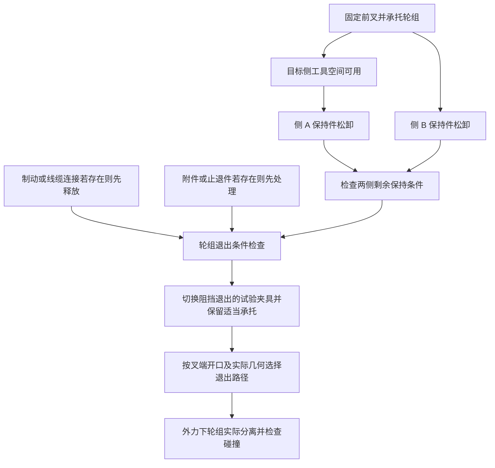

# 前轮外部紧固连接：实验规划

状态：设计草案，2026-10-27。以下的结构、力学关系、模块和实验均未实现或运行。本轮不修改现有自行车，也不把候选假设写回既有物理报告。

## 1. 先做哪一个连接

首例选择**前轮一侧的候选外六角轴端螺母**，工具采用与假设接口相匹配的扳手或套筒代理。它不是螺丝刀接口；若证据确认是防盗端帽、快拆或其他制式，应切换连接假设，不能继续套普通螺母模型。

### 第一步：一侧保持件的旋松和取出

保持前叉固定，轮组受承托，轮轴有明确抗转夹具；另一侧保持件不拆。目标是从局部证据与几何形成一个连接假设，生成阻力和螺旋约束，执行旋松，并在脱扣后用同轴拉力取出螺母。

该步骤只证明假设连接件可操作、可释放。即使目标螺母已取出，另一侧保持件仍存在，**整只前轮不应被宣称已解除连接**。不得固定正在被验证取出的螺母；轮组支撑也不能误接到螺母，使分离试验失效。

### 第二步：两侧保持关系解除后的整轮退出

在第一步成立后，再加入两侧保持件、必要垫圈/止退件和叉端接口。普通螺母配开放叉端只是一个显式候选配置。两侧保持条件、制动连接、附件连接和几何通道共同决定轮组能否退出，不能仅以“两个螺母都变成 loose”触发整轮释放。

两侧螺母不一定需要完全取出才能拆轮，也不保证只旋松就够；应由所选叉端、保持件和止退几何决定。未知分支不补成无条件成功路径。

进入整轮退出前，明确第一步夹具如何切换：解除或移动会阻挡退出的轮轴抗转装置；轮组承托继续防止失控下落，但必须允许所测退出方向。前叉固定可以保留。否则测到的是试验夹具的保持，不能归因于实车连接。

轴承、内轴锁紧螺母、轮胎、辐条和悬挂内部不拆。尤其不能把外侧轮轴固定螺母与调节花鼓轴承预紧的内部锁紧螺母混为同一连接。

## 2. 连接假设与几何准备

Agent 的输入包含 E02/E06 等实际图像、所选资产快照、部件局部坐标、轴线候选、相邻表面及可选型号资料。模型名称和已有爆炸位移都不能作为连接真值。

| 项目 | 首例选项 | 保存方式 |
| --- | --- | --- |
| 轴端制式 | 普通外六角螺母，仅为候选 | 明确 `assumed`；与防盗端帽、快拆等备选并列 |
| 轮轴 | 轴端可被螺母旋拧的假设轴 | 轴径、轴向长度和螺纹区单独记录来源 |
| 外侧夹持堆叠 | 螺母、可选垫圈、叉端等的候选顺序 | 未观察项不自动生成成实车已知件 |
| 叉端 | 第一步为局部接口包络；第二步才选开口/闭口假设 | 第一步不验证整轮退出；第二步必须有可检查的几何 |
| 轮组内部 | 暂不拆分轴承，保留花鼓/轮组包络 | 轮轴与可旋转花鼓概念分开，不用轮组自转代替螺母旋转 |
| 夹具 | 前叉固定、轮组承托、轮轴抗转 | 属于实验环境，标明约束对象、允许方向和作用范围 |

保留简化轮胎、轮圈、花鼓、前叉、制动外壳及挡泥板等可能阻挡工具的形状，不需要精细重建全部辐条。首例可把远离工具的辐条合并为外观层，但不能删除实际挡路的附件来取得可达性通过。

螺母采用无细牙的孔与外六角，轮轴采用光滑圆柱及语义螺纹区。要检查碰撞代理是否填死螺母中心孔；凸包外观正确不代表可退出。需要排除的简化接触对逐项声明，不能永久关闭所有碰撞来完成拆卸。

## 3. 简化旋拧模型

### 3.1 旋转—轴向关系

在指定轴坐标中，设螺母相对轮轴的连续转角为 θ，轴向位置为 z，带符号的每转导程为 ℓ（m/turn）：

`z − z₀ = h(θ − θ₀)，h = ℓ / (2π)`

只有所选螺纹已啮合时才保持该关系。若将螺距 p 与头数 n 分开，导程为 n·p，并另记旋向。首轮可假设单头螺纹，但不能把“螺距”和“每转进给量”无条件当作同一个字段。

θ 必须从螺母相对轴的真实转动解缠绕获得；扳手回摆、套筒空转、轮组自转和超过 ±π 的表示跳变都不能累计成旋松进度。两侧采用不同外法线时，数值正负可能不同，不能把相同世界坐标力矩符号直接视为两侧相同松卸方向。

### 3.2 阻力和抗转

首例采用可声明的静止保持阈值和运动阻力：低于假设松脱阈值保持静止；超过阈值且方向正确后，使用随连接状态变化的阻力矩与阻尼。运行阶段阻力始终反对相对运动，参数不可由 Agent 在失败后任意调低以迎合测试。

松脱阈值、运行阻力、导程及初始啮合量均为待校准假设。厂商安装扭矩不能直接等同于松脱扭矩，也不能从外六角大小推出真实摩擦或预紧。首轮不指定所谓实车数值。

轮轴抗转由显式夹具承担；否则可能出现螺母带动轮轴、相对转角很小的情况。工具作用和轴的反作用要成对记录；不能只在螺母上施加无限力矩却忽略整组旋转。若使用夹持力或预紧代理，它仅用于声明的状态与保持规则，不冒充材料弹性、真实接触压力或经过辨识的力学量。

理想螺旋约束还允许轴向外力回驱旋转；轴向力对螺旋自由度产生的广义驱动力矩为 h·F。静止与运动阻力应针对总广义驱动判断，不能只看工具力矩。后端若已经通过约束传递轴向力，就不要重复添加同一份等效力矩。

### 3.3 后端选择

后续实现先比较以下两种候选，不在规划中预认定 API 已可用：

| 候选 | 意义 | 首先需验证的技术点 |
| --- | --- | --- |
| 求解器中的理想螺旋/旋转—直线耦合 | 用约束将旋转和平移关联，输入仍是力和力矩 | 本机 Isaac 的接口、Artisan/USD 跨域映射、单位、反作用和运行时释放 |
| 带力反馈的柔性等效约束 | 对 `C = z − z₀ − h(θ − θ₀)` 的误差施加恢复力及一致的反力矩 | 数值稳定性、耦合残差、时间步敏感性和释放时是否产生异常冲量 |

柔性约束可参考 `F_c = −kC − d·Ċ`，其共轭力矩应满足 `τ_c = −hF_c`；该式只是等效模型设计，不是已测得的螺纹定律。大刚度不能当作精度保证。

若后端只能每帧直接设置 z 或 θ 来满足关系，这条路线只能标为运动学演示，不作为简化动力学通过。Agent 生成的参数需由受信任解释器执行；不让模型临时编写不受约束的运行回调。

## 4. 状态与约束释放

工具状态与连接状态分开保存。工具可以处于未接触、对齐、啮合或脱离；工具脱离并不改变螺纹剩余啮合量。

连接状态建议为：

| 状态 | 含义与观察 | 仍保留的约束 |
| --- | --- | --- |
| `clamped` | 初始夹紧，在声明阈值内不产生旋松 | 夹紧保持及螺纹约束 |
| `loosening` | 正确工具作用下已发生相对转动，夹紧代理尚在衰减 | 螺纹仍啮合，不能直接拉出 |
| `loose_threaded` | 夹紧保持已解除，但还存在有效啮合 | 轴向进给仍与转角耦合 |
| `thread_clear` | 有效螺纹重叠低于冻结容差，解除相应耦合 | 其他接触、附件和安全保持条件照常存在 |
| `removed` | 在后续外力下发生实际轴向分离、达到分离间隙且不穿透 | 不再有该螺母的连接保持；其他连接不受影响 |

夹紧保持与螺纹保持必须独立：预紧解除不代表螺母已经脱扣。状态切换根据实际相对运动、几何啮合量及已冻结规则触发，不能用“工具转了几秒”替代观测。

解除条件依据模型中声明的有限螺纹区与螺母内啮合区，不只把整根螺母长度当作有效啮合量。脱扣后取消螺旋约束及仅用于模拟螺纹的人工导向，恢复合理的碰撞关系；仍包围光轴、孔口或轴端的实际几何接触应保留。退出相应包络后不得残留无限铰链/滑轨，使螺母仍永远挂在轴上。

`breakTorque` 是受载破断阈值，不作为正常松卸的快捷开关。正常路径是松脱、退扣、解除，再验证取出。

首轮只验证拆卸。重新装上涉及对轴、接触捕获、重新啮合与夹紧重建，不能把拆卸轨迹倒放或自动吸附视为已经完成装配。

## 5. 工具空间和前轮依赖

工具代理包含接口形状、头部/套筒尺寸、有效咬合深度和手柄包络。采用扳手时，还需检查摆角及重新啮合的空间；只有工具中心轴不碰撞不算可达。首轮可用理想化啮合连接传力，但须标明它不验证真实接触滑移、打滑或脱牙。

工具可达性先指几何接近和操作空间，不含机器人运动学。检查结果应注明是连续路径检测还是离散采样；采样无碰撞不能称为全路径保证。

第二步整轮退出的条件图如下，具体分支按证据和所选假设启用：

图中的制动、线缆、附件不是已确认存在的特定型号结构，也不是可无条件跳过的节点。若真实任务要求完整拆轮而关键分支未知，应输出未解决；只验证假设夹具时则明确限制范围。

## 6. 计划运行的具体实验

所有实验在实现后运行。资产、协议、工具几何、夹具、阻力参数、时间步和容差先冻结；同一候选的对照只改变明确的实验变量。

| 实验 | 输入及操作 | 必须检查的实际结果 |
| --- | --- | --- |
| 零输入基线 | 不旋拧、不拉离 | 不自行旋松、漂移或误触发释放；夹具和质量状态有限 |
| 未啮合工具 | 保持相近工具运动，但无有效啮合 | 不向螺母传递理想连接力矩，不累计虚假进度 |
| 低扭矩对照 | 正确啮合，低于冻结松脱阈值 | 相对运动在静止容差内，无释放 |
| 错误旋向 | 有界的小幅反向输入 | 不计为松卸，不越过座面或导致未建模损伤；到界限明确停止 |
| 正常旋松 | 正确方向及超过阈值的输入 | 相对角度和轴向位移匹配声明导程；余下啮合逐渐减少 |
| 脱扣前拉离 | 在仍啮合时施加冻结同轴拉力，明确时长及转动保持/抗回驱条件 | 不得仍啮合却直接轴向穿出；若发生回驱旋转，记录转角与啮合变化，按正常退扣规则判断 |
| 脱扣后拉离 | 解除螺纹约束后施加同一拉力 | 实际分离、间隙增大，无穿透，不残留隐藏导向约束 |
| 单侧未释放 | 只移除目标侧，另一侧仍有已声明的夹紧/轴向保持，叉端几何与其匹配 | 可以取出目标螺母，但不能误报整轮已自由；不是仅凭另一侧螺母“存在”判阻挡 |
| 工具被阻挡 | 加入已声明的附件或障碍 | 可达性被拒绝；不得通过禁用障碍碰撞修复 |
| 条件依赖 | 第二步中保留某个止退/制动连接 | 在其几何或连接模型确实阻挡时，不允许整轮退出 |
| 数值复核 | 固定参数并减小时间步、重载初态再运行 | 释放阈值与顺序不因角度环绕或时间步改变而失真；容差变化须有独立依据 |

报告分别列出“连接假设有效性”“模型执行正确性”“路径/分离结果”。状态机走完只证明规则运行；动力学轨迹通过也只验证所声明的简化模型，不能推出真实扭矩、制造可用或机器人操作成功。

## 7. 以后实施的顺序与产物

1. **锁定前轮输入快照**：选择一套几何作为基线，关联原始证据和稳定零件 ID；不要混用两套自行车的坐标及尺度。形成连接候选与未知项。
2. **做一侧连接的最小后端试验**：独立刚体、旋转—轴向关系、阻力、脱扣与自由分离；不把可拆连接硬塞入原整车的不可变 articulation 树。
3. **接入 Agent**：让 Agent 提出接口及参数来源，确定性几何检查拒绝无效候选；保留人工字段覆盖。手填夹具用于验证后端，不能计作 Agent 已推断成功。
4. **运行上述对照并反馈**：几何错、关系错、工具空间错、后端不支持和数值不稳分别给反馈；修复者不能改冻结测试来取得通过。
5. **扩展到整轮退出**：加入另一侧、叉端实际出口和条件依赖；最后再讨论重新装回。

未来产物应包含连接图、假设/覆盖记录、交互模型、原始 USD、运行时约束事件、力矩/力/状态轨迹和独立检查报告。运行时允许改变约束，但不改写原始资产文件；事件需要保存约束 ID、前后状态、触发测量和配置哈希，便于重载重放。

本轮只完成文档，不创建这些未来执行产物，也不承诺尚未实测的后端能力。
